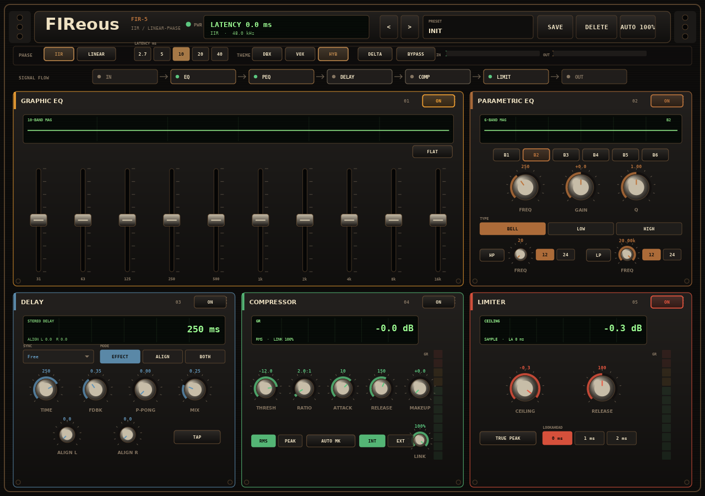

# FIReous

> **v0.1.0.** DSP and the custom hardware-style UI are in place. Expect
> parameter/API changes before a stable release.

FIReous is a stereo insert processor with two EQ engines:

- **IIR (default)** — RBJ biquads, near-zero latency, nonlinear phase.
- **LINEAR PHASE (FIR)** — a linear-phase FIR EQ/PEQ block. This is the mode
  that does not change the phase of the incoming signal (apart from a fixed
  delay); it is intended mainly for mastering.

The plugin is a single stereo insert. Multiband routing and per-band
processing are left to the DAW (use several FIReous instances on bands
created by the host).



## Chain

```
IN L/R (+ optional sidechain L/R)
  → Input Trim
  → Graphic EQ (10 bands)
  → Parametric EQ (6 bands + HP/LP)
  → Delay (effect + per-channel align)
  → Compressor (global per instance)
  → Limiter (global per instance)
  → Output Gain
OUT L/R
```

Modules are reorderable and bypassable. In IIR mode the linear modules
(EQ/PEQ/delay) commute, so reordering changes the workflow but not the
sound; compressor/limiter order does matter.

## IIR vs LINEAR

| Mode | Latency | Phase | Use |
|---|---:|---|---|
| IIR | ~0.1 ms | nonlinear | everyday mixing, tracking |
| LINEAR | 10 ms default | linear (no phase change) | mastering, phase-critical work |

In LINEAR mode the EQ and PEQ are combined into one FIR when they are
adjacent. The FIR length is derived from the selected latency:

- 2.7 ms ≈ 256 taps (low-latency preview, limited low-frequency resolution),
- 10 ms ≈ 961 taps (default),
- 20/40 ms (mastering, longer latency, better low-frequency resolution).

The reported latency includes the FIR group delay and the limiter's
lookahead when enabled. The delay effect's own time is an effect, not
reported processing latency.

## UI

The UI is a fixed 1280×900 hardware-DSP panel, scaled by the UI-scale button:

- five module cards in a 3×2 rack; the first chain position gets a
  double-width slot (the Graphic EQ is wide by default),
- small LCDs in each module (EQ/PEQ curves, delay time/align, compressor/
  limiter gain reduction),
- 10 vertical EQ faders, hardware-style knobs, LED GR meters,
- drag module headers to reorder the chain,
- preset bar with prev/next/save/delete and inline name editing,
- `DBX` / `VOX` / `HYBRID` themes (theme is saved in
  `~/.config/fireous/theme`),
- `AUTO`/fixed UI scale (`~/.config/fireous/ui-scale`).

Theme previews:

- [DBX](docs/ui-live-dbx.png)
- [VOX](docs/ui-live-vox.png)
- [LINEAR mode](docs/ui-live-linear.png)

The design mockup is in [docs/ui-hardware-mockup.png](docs/ui-hardware-mockup.png),
generated by [`tools/mockup_hardware.py`](tools/mockup_hardware.py).

## Current status

Implemented:

- IIR graphic EQ, PEQ with HP/LP, delay with per-channel align,
  compressor (RMS/peak, link, auto-makeup, sidechain key), limiter
  (lookahead, sample/true-peak estimate), chain reorder, bypass,
  input/output trim, Delta monitor, meters.
- LINEAR phase FIR design for the EQ/PEQ block (combined when adjacent),
  with reported latency.
- Sidechain input bus (stereo).
- Hardware-style Cairo UI with presets, themes, UI scale and drag reorder.
- Standalone DSP tests: flat identity, FIR latency/impulse position,
  EQ gain, compressor, limiter ceiling, delay align, reorder invariance,
  Delta monitor, external sidechain, biquad responses, FIR symmetry.

Known limitations:

- FIR coefficient changes use a block-boundary swap without a crossfade
  (can click while dragging in LINEAR mode).
- `true peak` is a simple 4× inter-sample estimate, not a full oversampled
  true-peak detector.
- Sidechain is aligned to full FIR latency (correct for the default
  compressor-after-EQ/PEQ order).
- No internal crossover/multi-out; per-band means multiple instances.

## Build

```sh
git clone --recursive <repo-url>
cd fireous
./install.sh --all
```

Or:

```sh
cmake -S . -B build -DCMAKE_BUILD_TYPE=Release
cmake --build build -j"$(nproc)"
```

Built plugins land in `build/bin/`: `fireous.vst3`, `fireous.lv2`,
`fireous.clap`, and `fireous` (JACK/standalone).

Run the DSP tests:

```sh
cmake -S tests -B build-tests -DCMAKE_BUILD_TYPE=Release
cmake --build build-tests -j"$(nproc)"
ctest --test-dir build-tests --output-on-failure
```

## Design notes

- **No internal crossover / multi-out.** The DAW already owns routing.
  Per-band processing means multiple FIReous instances in the host.
- **IIR is the default.** It is the near-zero-latency mode, but it changes
  phase. Only LINEAR mode promises a phase-linear EQ/PEQ.
- **Compressor/limiter are dynamics, not FIR filters.** They are
  zero-latency by default; the limiter can optionally use lookahead and a
  simple true-peak estimate.
- **Reorder is about workflow for the linear modules**; it is sonically
  meaningful for the compressor/limiter.

## License

ISC. See [LICENSE](LICENSE).
